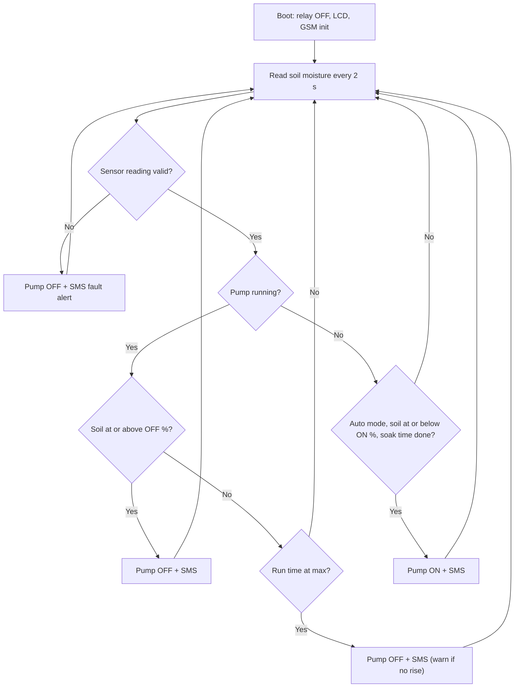

# 🌱 Smart Garden Soil & Watering Orchestrator

An Arduino Mega 2560 irrigation controller that reads soil moisture, waters **only when the soil actually needs it**, and keeps you informed over **GSM SMS**, with no Wi-Fi or internet needed. You can also control it by text message from anywhere with mobile coverage.

---

## ✨ Features

- **Automatic irrigation**: pump turns ON below a dry threshold and OFF above a wet threshold (hysteresis, so the relay never chatters)
- **Reduces water wastage**: soak time between cycles lets water reach the sensor before the next decision
- **Pump safety**: hard maximum run time per cycle, even while the GSM modem is busy
- **Fault detection**: SMS alert if the sensor reads out of range; watering is disabled until it recovers
- **"Not rising" warning**: SMS if moisture barely improves after a full cycle (empty tank, blocked pipe, or bad sensor)
- **SMS control**: `STATUS`, `WATER`, `STOP`, `AUTO ON`, `AUTO OFF`, accepted from the owner number only
- **Live 20x4 I2C LCD**: moisture %, raw value, pump state, mode, GSM status
- **Serial debug output** at 9600 baud, useful for calibration

---

## 🧰 Hardware

| Part | Qty | Notes |
|------|-----|-------|
| Arduino Mega 2560 | 1 | Uses hardware `Serial1` for the modem |
| SIM800A GSM module | 1 | **2G only**, so use a SIM with 2G coverage |
| Capacitive soil moisture sensor (v1.2) | 1 | Analog output |
| 1-channel relay module (5 V) | 1 | Active-LOW by default |
| DC water pump / solenoid valve | 1 | Powered from its own supply |
| 20x4 LCD with I2C backpack | 1 | Address `0x27` (or `0x3F`) |
| External supply for GSM | 1 | Check your board's spec (typically 4-5 V, 2 A peak) |
| Flyback diode (1N4007) | 1 | Across a DC pump or valve coil |
| Jumper wires, enclosure, tubing | - | |

---

## 🔌 Wiring

```
                         +---------------------------+
 Soil sensor AOUT -----> | A0                        |
                         |                           |        +-------------+
                         |       ARDUINO MEGA 2560   |        |   SIM800A   |
                         |                     TX1 18| -----> | RX          |
                         |                     RX1 19| <----- | TX          |
                         |                           |        +-------------+
 Relay IN <------------- | D7                        |
 LCD SDA  <------------> | D20 (SDA)                 |
 LCD SCL  <------------- | D21 (SCL)                 |
                         +---------------------------+
```

| From | To (Mega 2560) |
|------|----------------|
| Soil sensor VCC / GND / AOUT | 5V / GND / A0 |
| Relay VCC / GND / IN | 5V / GND / D7 |
| LCD VCC / GND / SDA / SCL | 5V / GND / D20 / D21 |
| SIM800A TX | D19 (RX1) |
| SIM800A RX | D18 (TX1), via a level shifter or divider if your board is not 5 V tolerant |
| SIM800A GND | GND (**common ground with the Mega**) |
| Pump | Separate supply, wired through relay COM / NO |

> ⚠️ Power the SIM800A from its own supply that can deliver 2 A bursts. Powering it from the Mega's 5 V pin causes random resets and SMS failures.

<!-- Add your own photos:  -->

---

## 🧠 How it works



Moisture % is computed from the raw ADC value using two calibration points (dry air and water), averaged over 10 samples.

---

## 📲 SMS commands

Send these from the number set as `OWNER_NUMBER`. Messages from any other number are ignored.

| Command | Action |
|---------|--------|
| `STATUS` | Replies with moisture %, raw value, pump state and mode |
| `WATER` | Starts a manual cycle (refused if the soil is already wet or the sensor is faulty) |
| `STOP` | Stops the pump immediately |
| `AUTO ON` | Enables automatic watering |
| `AUTO OFF` | Disables automatic watering (manual `WATER` still works) |
| anything else | Replies with the command list |

Automatic SMS alerts: watering started, watering stopped (with reason and duration), sensor fault, and a startup message.

---

## 🚀 Getting started

1. **Install the library**: in the Arduino IDE open *Library Manager* and install **LiquidCrystal I2C** by Frank de Brabander.
2. **Open the sketch**: `SmartGarden_Orchestrator/SmartGarden_Orchestrator.ino`
3. **Set your number**: edit `OWNER_NUMBER` (with country code, e.g. `+91XXXXXXXXXX`).
4. **Select** *Tools → Board → Arduino Mega or Mega 2560*, choose the port, and upload.
5. **Calibrate** the sensor (below), then re-upload.
6. Insert an active 2G SIM (PIN lock disabled), power the modem, and reset the board. You should get an SMS saying *Smart Garden online*.

### Calibrating the sensor

1. Open the Serial Monitor at **9600 baud**. Each sample prints `raw=... soil=...%`.
2. Hold the sensor **in dry air** and note the raw value, then set `SENSOR_DRY_RAW`.
3. Dip it into a glass of water **up to the marked line** and note the raw value, then set `SENSOR_WET_RAW`.
4. Re-upload. Then tune `MOISTURE_ON_PCT` / `MOISTURE_OFF_PCT` for your plants and soil.

---

## ⚙️ Configuration

| Constant | Default | Meaning |
|----------|---------|---------|
| `OWNER_NUMBER` | `+91XXXXXXXXXX` | Number that receives alerts and may send commands |
| `SENSOR_DRY_RAW` / `SENSOR_WET_RAW` | 600 / 270 | Calibration points (raw ADC) |
| `RAW_FAULT_LOW` / `RAW_FAULT_HIGH` | 50 / 1000 | Raw values outside this range count as a sensor fault |
| `MOISTURE_ON_PCT` | 30 | Start watering at or below this |
| `MOISTURE_OFF_PCT` | 60 | Stop watering at or above this |
| `MIN_RISE_PCT` | 5 | Expected moisture gain per cycle, otherwise warn |
| `MAX_RUN_MS` | 60000 | Hard cap on pump time per cycle |
| `SOAK_MS` | 900000 | Minimum wait between automatic cycles (15 min) |
| `RELAY_ACTIVE_LOW` | `true` | Set `false` for active-HIGH relay modules |
| `LCD_ADDR` | `0x27` | I2C address of the LCD |

---

## 🛡️ Safety notes

- Keep mains or high-current pump wiring isolated from the logic side, and use a properly rated relay.
- Add a flyback diode across DC pumps and solenoid valves.
- Sending an SMS can block for up to ~20 s. The firmware still cuts the pump at `MAX_RUN_MS` during that time, but treat it as software protection only. For unattended use, add a physical backup such as a float switch or a hardware timer.
- Resistive soil sensors (FC-28 style) read high when dry and corrode quickly. Re-tune the calibration and `RAW_FAULT_HIGH` if you use one.

---

## 🔧 Troubleshooting

| Symptom | Likely cause |
|---------|--------------|
| `GSM: FAIL` on the LCD | Wrong wiring (TX/RX swapped), weak power supply, or no 2G coverage |
| No SMS but no errors | SIM has no balance, or the number format is missing the country code |
| LCD blank | Wrong `LCD_ADDR` (try `0x3F`) or contrast pot on the backpack |
| Pump runs at boot | `RELAY_ACTIVE_LOW` does not match your relay module |
| Moisture reads 0% or 100% all the time | Calibration values do not match your sensor |

---

## 📁 Repository structure

```
SmartGarden-Orchestrator/
├── SmartGarden_Orchestrator/
│   └── SmartGarden_Orchestrator.ino
└── README.md
```

---

## 🗺️ Roadmap

- Multi-zone support (several sensors and valves)
- Rain and temperature awareness
- Cloud logging and a dashboard
- Scheduled watering windows

---

## 📄 License

MIT. Free to use, modify, and share.

## 👤 Author

**Piyush Bopche** ([@Piyush9301](https://github.com/Piyush9301)), Electronics & Communication Engineering, LNCT Bhopal
